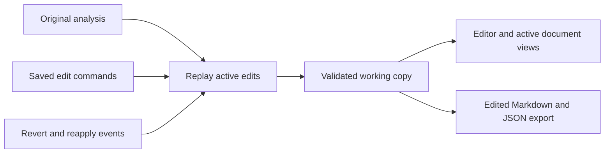

# Analysis editor

The analysis editor lets you correct the text and structure that Docling extracted from a PDF. It is available on a completed analysis that contains a Docling document. The PDF and the original conversion result remain available.

## Edit an analysis

1. Open **Analyses**, open a completed result, and click **Edit analysis**. If the button is unavailable, that analysis has no Docling document to edit.
2. Select an element in the structure tree or on the page. Edit supported text in the properties panel. For a heading, you can also change its level or turn it into body text or a title.
3. To merge paragraphs, select them with their checkboxes (or use Ctrl/Cmd-click in the tree), then click **Merge selected**. You can delete selected elements or move an element with **Choose move destination** or drag and drop. Tables, pictures, and other unsupported elements stay read-only.
4. Review the updated tree, page view, and Markdown. **Preview** refreshes the server's validation; the editor also requests previews as you work. A preview is still a draft.
5. Click **Save** to make the edits durable, or **Discard changes** to throw away the current draft. **Undo** and **Redo** work on pending edits before you save.

The editor keeps an unsaved draft in the current browser session so it can offer to restore it after a reload. If another tab or user saves first, the editor reports a conflict. Reload the saved result before trying again; copy your pending edits from the conflict notice if you need to keep them.

## Revert or reapply a saved edit

Open **History** in the editor. Each saved edit has a **Revert** or **Reapply** action and a current status. Reverting an edit updates the saved result but leaves the edit visible in the history. Reapply turns it on again. The toolbar's **Undo** and **Redo** use saved history when there are no pending edits to undo or redo.

Save or discard your current draft before changing saved history. If a later edit needs the one you are reverting, the editor rejects the action and keeps the saved result as it was. Revert the dependent edit first, then try again.

## Download and downstream use

While **Edit analysis** is open, **Download** exports the *saved* edited Markdown or Docling JSON. Save a draft before downloading if you want it included. **Inspect analysis** shows the original conversion result, and its Download action exports that original analysis. PDF download always returns the source PDF.

Each analysis has its own edit history. Starting a new conversion creates a new analysis and a new edit stream; it does not rewrite an older analysis. Document-scoped reads such as the active tree and rechunking use the active saved result. Existing chunks become stale after an edit and need explicit rechunking. **Ask** currently reads the latest completed conversion analysis, so it may not include editor changes.

The editor is controlled by `ANALYSIS_EDITOR_ENABLED` (on by default). When it is off, editing controls and editor API routes are unavailable; you can still inspect the original analyses.

## How the pattern works

The original Docling conversion is an **immutable base**. Each save appends versioned edit commands addressed by stable logical element IDs. The server replays the active commands in order, validates the resulting Docling document, and regenerates the Markdown, HTML, page data, and structure tree. It stores this result as a **working copy** so normal reads and exports do not replay every command.

A revert or reapply appends a history event pointing to a saved command; it does not delete or rewrite that command. For example, after edits `#1` and `#2`, reverting `#1` appends event `#3`. Replay then applies only `#2`. Reapplying `#1` appends event `#4`, and replay applies `#1` and `#2` in their original order. The complete history remains available for audit and rebuild.

Preview replays the saved state plus pending commands without writing to the database. Save replays and validates again, then appends the commands and replaces the working copy in one transaction. The request includes the sequence the editor last saw; a stale sequence produces a conflict instead of overwriting another save. The working copy is rebuildable from the immutable base and the full history.

For the API and persistence details, see the [analysis editor design](https://github.com/scub-france/Docling-Studio/blob/main/docs/design/analysis-editor.md).
