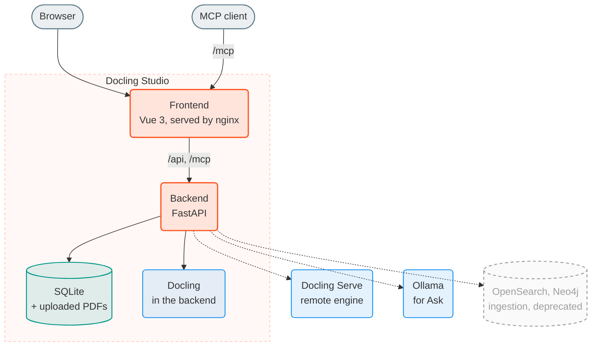
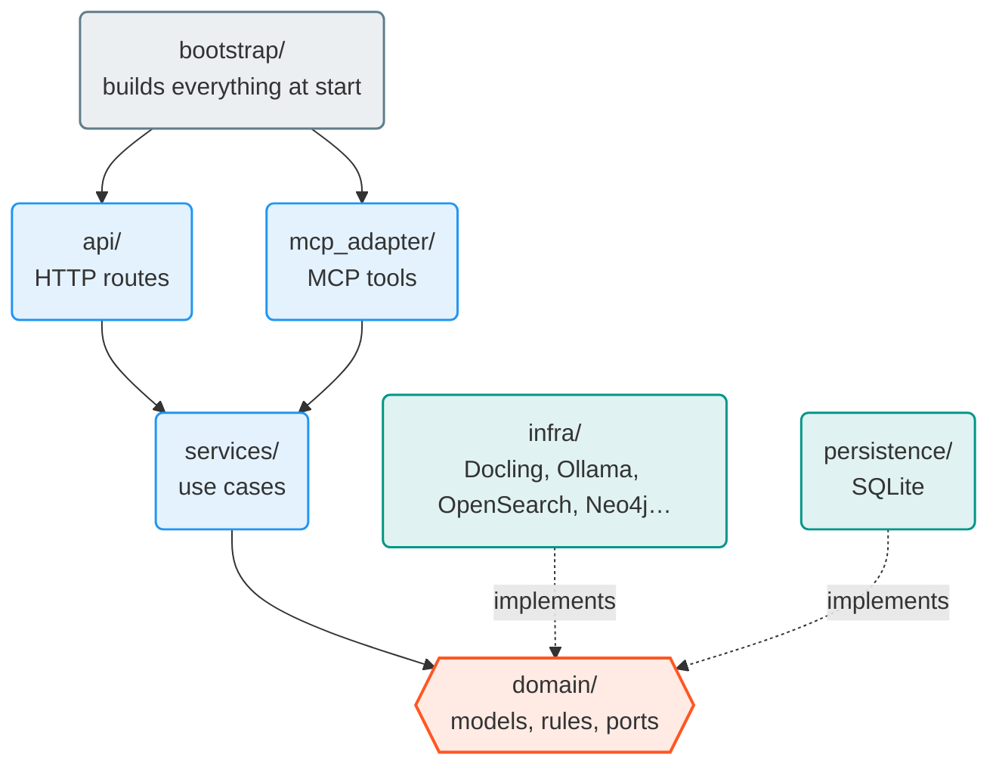
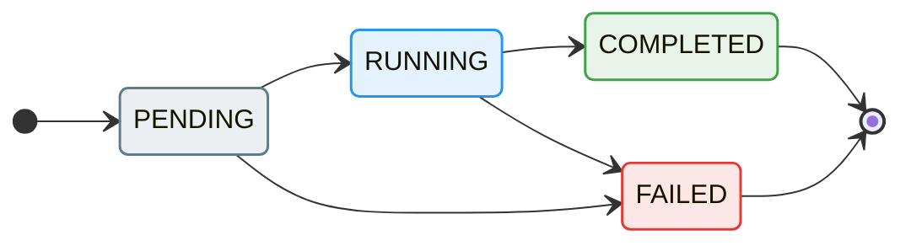

# Architecture

## The big picture

Dotted lines are optional. Grey and dashed means deprecated: ingestion (OpenSearch, Neo4j) goes away in 0.8.0. The published image puts nginx and the backend in one container (root `Dockerfile`). Docker Compose runs them as two containers.

| Folder | Content |
|--------|---------|
| `frontend/` | The web app: Vue 3, TypeScript, Vite, Pinia |
| `document-parser/` | The backend: FastAPI, Docling, SQLite |
| `embedding-service/` | Turns text into vectors, for ingestion only. Deprecated, removed in 0.8.0 |
| `e2e/` | End-to-end tests: Karate for the API, Karate UI in Chrome |
| `docs/` | This documentation, design docs, audit checklists |
| `experiments/`, `scripts/` | Research scripts and the demo recorder, not part of the app |

## Backend

The backend follows ports and adapters. The core (`domain/`) defines what the app needs; `infra/` and `persistence/` plug real tools into it.

`tests/test_architecture.py` scans Python imports and fails on new forbidden
layer dependencies. Existing exceptions are listed by source and target module
in that test until they are migrated:

| Layer | Never imports |
|-------|---------------|
| `domain` | Any other layer, FastAPI, SQLAlchemy, httpx, the OpenSearch client |
| `services` | `api`, `infra`, `persistence`, FastAPI, and the Docling, PDF, HTTP, graph, search and cryptography libraries: services reach them through ports |
| `api` | `infra`, `persistence` |
| `mcp_adapter` | `api`, `infra`, `persistence` |
| `infra` | `api`, `services` |
| `persistence` | `api`, `services`, `infra` |

`main.py` creates the app, mounts the routes and, unless `MCP_ENABLED=false`, the MCP server at `/mcp`. `bootstrap/` builds the adapters and services from the settings. `mcp_adapter/` publishes the MCP tools on top of the services, as `api/` does for HTTP. See [MCP server](mcp-server.md).

### API rules

- JSON is camelCase; Python is snake_case. Page data from Docling keeps snake_case (`page_number`).
- One route does one domain operation. When a screen needs several calls, the frontend chains them in its store. The only exception is an operation that must be atomic, and its service says why. The route list and the reasoning behind this rule: [design doc 269](https://github.com/scub-france/Docling-Studio/blob/main/docs/design/269-backend-ddd-audit.md).

| Prefix | What it serves |
|--------|----------------|
| `/api/documents` | Documents, their PDF (`/export`, `/preview`, `/pages`), chunks, versions, graph (Neo4j, deprecated), Ask (`POST /api/documents/{id}/reasoning`), and the [analysis editor](analysis-editor.md#api) (`/analysis-editor`, `/analysis-edits/…`) |
| `/api/analyses` | Analyses: start, import, list (in full or as light `/summaries`), read, rechunk and edit its chunks, delete |
| `/api/stores` | Ingestion targets (OpenSearch, Neo4j). Deprecated, removed in 0.8.0 |
| `/api/ingestion` | Sending chunks to stores, when ingestion is on. Deprecated, removed in 0.8.0 |
| `/api/config` | The reasoning and MCP settings edited in **Settings** (`/reasoning`, `/mcp`) |
| `/api/mcp` | Read only: what the MCP server published at start (`GET /api/mcp/server`) |
| `/api/health` | Status, engine, version, and the flags the frontend reads |
| `/mcp` | The MCP server itself (streamable HTTP), outside `/api`. See [MCP server](mcp-server.md) |

### An analysis

An analysis waits in `PENDING` until one of the `MAX_CONCURRENT_ANALYSES` slots is free. The result is stored in SQLite: Markdown and HTML, the pages with their boxes, and the full Docling document as JSON.

### Ask

`api/reasoning.py` calls `services/reasoning_service.py`, which runs [docling-agent](https://github.com/docling-project/docling-agent) through a port (`ReasoningRunner`). The adapter is `infra/docling_agent_reasoning.py`. `domain/trace_builder.py` turns the agent's raw result into the steps shown in the timeline.

## Frontend

| Folder | Content |
|--------|---------|
| `src/app/` | App shell and router |
| `src/pages/` | One component per route, plus a few components only those pages use |
| `src/features/<name>/` | One feature: `api.ts`, `store.ts`, `ui/`, and `index.ts` |
| `src/shared/` | HTTP client, FR/EN texts, types, shared UI |

A feature uses another feature only through its `index.ts`. ESLint enforces it (`no-restricted-imports`).

On start, the app reads `/api/health`. The answer decides which pages exist (`STUDIO_MODE_ENABLED`, `RAG_PIPELINE_ENABLED`), whether the Ask tab shows up (`ASK_MODE`, and a wired reasoning runner), and whether **Edit analysis** does (`ANALYSIS_EDITOR_ENABLED`).

## Going further

- [Bounding boxes](bbox-pipeline.md): how a Docling box becomes a rectangle on the page.
- [Design docs](https://github.com/scub-france/Docling-Studio/tree/main/docs/design): one per feature, named after its issue.
- [Architecture decisions](architecture/adr-guide.md), for example [ADR-001](architecture/adrs/ADR-001-graph-visualization-library.md) on the graph library.
