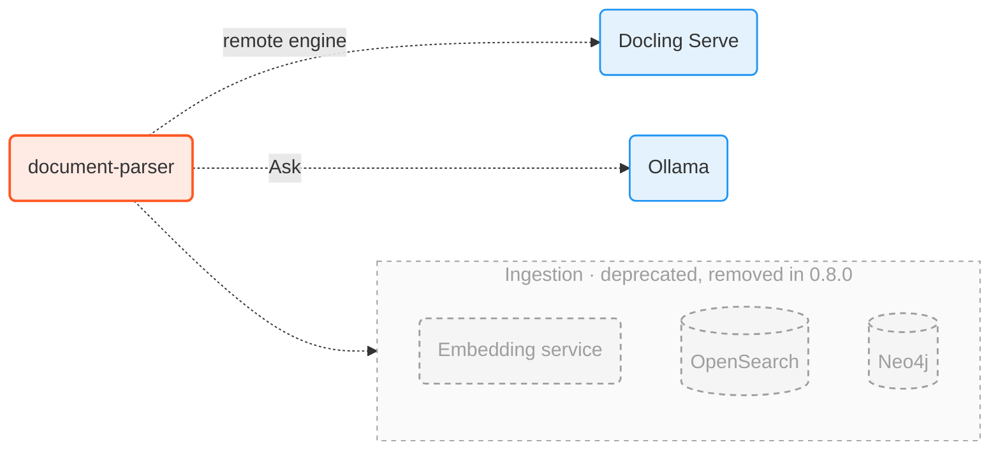

# Configuration

Docling Studio reads its settings from environment variables. This page lists the ones you are likely to change; the full list is in [`document-parser/infra/settings.py`](https://github.com/scub-france/Docling-Studio/blob/main/document-parser/infra/settings.py).

- With `docker run`, pass them with `-e NAME=value`.
- With Docker Compose, put them in a `.env` file next to `docker-compose.yml`. Compose only forwards the variables listed under `document-parser` › `environment` in `docker-compose.yml`. To set another one, add it there or in a `docker-compose.override.yml`.

The server checks most values when it starts. If one is invalid, it does not start and the logs say which one.

## Analysis

| Variable | Default | What it does |
|----------|---------|--------------|
| `CONVERSION_ENGINE` | `local` | `local`: Docling runs in the backend. `remote`: PDFs go to Docling Serve. The `-local` and `-remote` images set it for you. |
| `DOCLING_SERVE_URL` | `http://localhost:5001` | Docling Serve address. Remote engine only. |
| `DOCLING_SERVE_API_KEY` | empty | Key sent to Docling Serve, if it needs one. |
| `DEFAULT_TABLE_MODE` | `accurate` | How tables are read: `accurate` or `fast`. |
| `MAX_CONCURRENT_ANALYSES` | `3` | How many analyses run at the same time. |
| `CONVERSION_TIMEOUT` | `900` | Seconds before an analysis is stopped. |
| `BATCH_PAGE_SIZE` | `0` (compose: `10`) | Local engine only. Converts long PDFs in batches of this many pages, which bounds memory use and shows the progress after each batch. A table that runs across two batches comes out as two tables. `0` converts in one pass. |

Two more timeouts exist, in seconds: `DOCUMENT_TIMEOUT` (120) and `LOCK_TIMEOUT` (300). The server only starts if `DOCUMENT_TIMEOUT` < `LOCK_TIMEOUT` < `CONVERSION_TIMEOUT`. So a `CONVERSION_TIMEOUT` of 300 or less needs a lower `LOCK_TIMEOUT` as well.

## Limits

| Variable | Default | What it does |
|----------|---------|--------------|
| `MAX_FILE_SIZE_MB` | `50` | Largest upload, in MB. `0` means no limit. |
| `MAX_PAGE_COUNT` | `0` | Most pages per PDF. `0` means no limit. |
| `MAX_FILE_SIZE` | `0` | Local engine only. Largest file Docling itself accepts, in bytes. `0` means no limit. Uploads are already capped by `MAX_FILE_SIZE_MB`. |
| `MAX_IMPORT_SIZE_MB` | `200` | Largest Docling JSON accepted by **Import analysis** (`POST /api/analyses/import`), in MB. Over it, the backend answers `413`. `0` means no limit. A JSON with page or picture images embedded is much larger than the same JSON without them. |
| `NGINX_MAX_BODY_SIZE` | `200M` | Body limit in nginx for every `/api` request, in nginx format. Over it, nginx answers `413` itself, before the backend. Keep it at least as large as `MAX_FILE_SIZE_MB` and `MAX_IMPORT_SIZE_MB`. With the defaults it equals `MAX_IMPORT_SIZE_MB`, so an import over 200 MB gets nginx's `413` page rather than the backend's message: raise both together. |
| `RATE_LIMIT_RPM` | `100` | Requests per minute per client address, as the backend sees it. Behind the bundled nginx, that address is nginx itself, so all users share the limit. `0` turns it off. `/api/health` is not counted. |
| `MAX_PASTE_IMAGE_SIZE_MB`, `PASTE_ALLOWED_IMAGE_TYPES` | `10`, `image/png,image/jpeg,image/webp` | Limits for pasted images. `/api/health` reports them, but no screen uses them yet. |

## Ask

Ask is hidden by default. `ASK_MODE=visible` shows it: the Ask tab in the Parse view and **Settings** › **Reasoning**. Hidden, neither shows, even when reasoning was turned on in **Settings**. `ASK_MODE` only hides Ask: the reasoning API still answers as the values below say.

The other values are starting values. **Settings** › **Reasoning** in the app can change them while the server runs. After a **Save** there, the four values come from the database until you click **Reset to environment**.

| Variable | Default | What it does |
|----------|---------|--------------|
| `ASK_MODE` | `hidden` | `visible` shows Ask in the app, `hidden` hides it. |
| `REASONING_ENABLED` | `false` | Turns Ask on. The reasoning packages must be in the image. |
| `OLLAMA_HOST` | `http://localhost:11434` | Ollama address, as seen from the backend. In a container, use `http://host.docker.internal:11434`. |
| `REASONING_MODEL_ID` | `gpt-oss:20b` | Default model. It must be pulled in Ollama. |
| `REASONING_MAX_ITERATIONS` | `5` | Most reasoning steps per question, from 1 to 20. |
| `LLM_PROVIDER_TYPE` | `ollama` | **Deprecated**, to be removed: Ask runs on Ollama only. Leave it unset. Any other value keeps Ask off and logs a warning at start-up, as before. **Settings** › **Reasoning** shows it read-only. |

## Feature switches

| Variable | Default | What it does |
|----------|---------|--------------|
| `RAG_PIPELINE_ENABLED` | `true` | The Docs and Runs pages. |
| `STUDIO_MODE_ENABLED` | `false` | The older Studio pages (`/studio`, `/history`, `/documents`, `/search`), which still hold chunking and ingestion (deprecated). |
| `ANALYSIS_EDITOR_ENABLED` | `true` | The [analysis editor](analysis-editor.md): its screens, its API and the `edited=true` exports. `false` hides editing; the editor routes and `edited=true` exports answer `404`, and you can still inspect analyses. Edits saved before keep applying to the active result: default exports, document tree and rechunking still include them. |
| `INSPECT_MODE_ENABLED` | `true` | The document page opened from **Docs** (`/docs/{id}`). `false` sends that page back to the Docs list. Only with `RAG_PIPELINE_ENABLED=true`. |
| `LINKED_MODE_ENABLED` | `true` | `/api/health` reports it, but no screen reads it. |

At least one of `RAG_PIPELINE_ENABLED` and `STUDIO_MODE_ENABLED` must be `true`.

## Optional services



None of them is needed to import and analyze PDFs.

### Ingestion (deprecated)

> **Deprecated.** Ingestion will be removed in 0.8.0, with everything built on it: the embedding service, OpenSearch, Neo4j and its graph view, the stores and the chunk search. Avoid it in new setups.

Ingestion sends chunks to OpenSearch or Neo4j. It turns on when `EMBEDDING_URL` is set together with `OPENSEARCH_URL` or `NEO4J_URI`. Only the older Studio pages use it, so it also needs `STUDIO_MODE_ENABLED=true`.

| Variable | Default | What it does |
|----------|---------|--------------|
| `EMBEDDING_URL` | empty | Embedding service address. Empty means no ingestion. |
| `OPENSEARCH_URL` | empty | OpenSearch address. Empty means OpenSearch is not used. |
| `EMBEDDING_DIMENSION` | `384` | Vector size. It must match the embedding model. |
| `NEO4J_URI` | empty | Neo4j address, for example `bolt://neo4j:7687`. Empty means Neo4j is not used. |
| `NEO4J_USER`, `NEO4J_PASSWORD` | `neo4j`, `changeme` | Neo4j login. Change the password. |
| `STORE_SECRET_KEY` | empty | Encrypts store passwords in the database. Required as soon as a store has a password, and it must never change. |
| `OPENSEARCH_DEFAULT_LIMIT` | `1000` | Most chunks read back from OpenSearch in one request. |
| `DEFAULT_EMBEDDER` | `bge-m3` | Embedder name given to the `default` store when the backend creates it, at first start. Ignored once that store exists. |

Create a `STORE_SECRET_KEY` with the image itself:

```bash
docker run --rm ghcr.io/scub-france/docling-studio:latest-remote python -c "from cryptography.fernet import Fernet; print(Fernet.generate_key().decode())"
```

With Docker Compose, the `ingestion` profile starts OpenSearch, the embedding service and Neo4j, and the extra file connects the first two:

```bash
docker compose --profile ingestion -f docker-compose.yml -f docker-compose.ingestion.yml up --build
```

For Neo4j, also put `NEO4J_URI=bolt://neo4j:7687` in `.env`. The embedding service reads `EMBEDDING_MODEL` (default `all-MiniLM-L6-v2`) and `EMBEDDING_BATCH_SIZE` (default `64`).

These compose settings are for a laptop: OpenSearch runs without security and Neo4j with the default password. Do not expose them.

## Deployment

| Variable | Default | What it does |
|----------|---------|--------------|
| `DEPLOYMENT_MODE` | `self-hosted` | `huggingface` shows a demo banner and makes **Settings** › **Reasoning** read-only. |
| `CORS_ORIGINS` | `http://localhost:3000,http://localhost:5173` | Browser origins allowed to call the API, comma-separated. Only needed when the UI is served from another address. |
| `API_ALLOWED_HOSTS` | empty | `Host` names `/api` answers, comma-separated. Empty: no check. See [Host check on the API](#host-check-on-the-api). |
| `UPLOAD_DIR` | `/app/uploads` in the images, `./uploads` from source | Folder for uploaded PDFs. |
| `DB_PATH` | `/app/data/docling_studio.db` in the images, `./data/docling_studio.db` from source | SQLite database: documents, analyses, edits, stores and settings saved in the app. |
| `APP_VERSION` | `dev` | Version shown in the app. The release build sets it. |

### Host check on the API

`API_ALLOWED_HOSTS` is empty by default, and then `/api` answers whatever `Host` header a request carries. **On a workstation, that leaves `/api` open to DNS rebinding**: a web page you visit can point its own domain name at `127.0.0.1` and then read and change your documents through your browser. CORS does not stop it, because the browser takes those calls as same-origin.

Set `API_ALLOWED_HOSTS` to turn the check on. A request to `/api/*` whose `Host` is not listed, or is malformed, then gets `421` with `{"detail": "Invalid Host header"}`. For a local install:

```
API_ALLOWED_HOSTS=localhost,127.0.0.1,[::1]
```

- Only the host name is compared: against DNS rebinding the port does not matter, and the bundled nginx forwards `Host` without it. An entry may carry a port (`name:3000`, `name:*`) so that one list can serve `MCP_ALLOWED_HOSTS` too; the port is ignored here. `*` means no check.
- `localhost`, `127.0.0.1` and `[::1]` are always accepted once the check is on, so health checks such as `curl http://localhost:8000/api/health` keep working.
- If people open Studio by a LAN name, an IP address or a domain, list it: `API_ALLOWED_HOSTS=localhost,studio.lan`. Behind your own proxy, list the name the proxy forwards in `Host`.
- Only `/api/*` is checked. `/mcp` has its own list; the web app itself is static.
- At start-up, the backend logs one line saying whether the check is on and for which hosts.

### Behind your own proxy

The PDF viewer does not download the whole PDF first. It loads it in the browser with PDF.js and asks the backend for the parts it needs, with HTTP `Range` requests on `GET /api/documents/{id}/export?format=pdf`. The bundled nginx passes them through as is.

If you put another proxy in front of Studio, let `Range` requests through and return the `206 Partial Content` answer unchanged. A proxy that drops the `Range` header, or answers with the full file instead, still works: the browser downloads the whole PDF before it shows a page, which is slower on large files.

When PDF.js cannot load the PDF or draw a page, the page falls back to an image rendered by the backend: `GET /api/documents/{id}/preview?page=N&dpi=150&format=webp`.

| Parameter | Default | Values |
|-----------|---------|--------|
| `page` | `1` | 1 to the page count. Past the last page: `400`, or `404` when the document's page count is not known. |
| `dpi` | `150` | 72 to 300. |
| `format` | `png` | `png` or `webp`. |

The backend keeps the rendered images in memory, up to 64 MB per backend process, and drops the least recently used first. This size cannot be changed. The answer carries `Cache-Control: private, max-age=86400, immutable`, so the browser also keeps each image for a day.

## Build options

Used when you build the image yourself, with `docker build --build-arg` or as variables for `docker compose up --build`.

| Name | Default | What it does |
|------|---------|--------------|
| `CONVERSION_MODE` | `local` | Compose only. Which image to build: `local` or `remote`. |
| `WITH_REASONING` | `false` | Installs the packages Ask needs. `local` image only. |
| `BAKE_MODELS` | `false` | Downloads Docling's models into the image at build time. `local` image only. The backend does not point Docling at this copy yet, so the first analysis still downloads them. |
| `APP_VERSION` | `dev` | Version baked into the single image (root `Dockerfile`). |

Example, the single image with Ask:

```bash
docker build --target local --build-arg WITH_REASONING=true -t docling-studio .
```

## Where data lives

| Setup | Database and PDFs |
|-------|-------------------|
| `docker run` | Inside the container, in `/app/data` and `/app/uploads`. Mount volumes to keep them. |
| `docker-compose.yml` | Docker volumes `db_data` and `uploads_data`. |
| `docker-compose.dev.yml` | `document-parser/data` and `document-parser/uploads` in your clone. |
