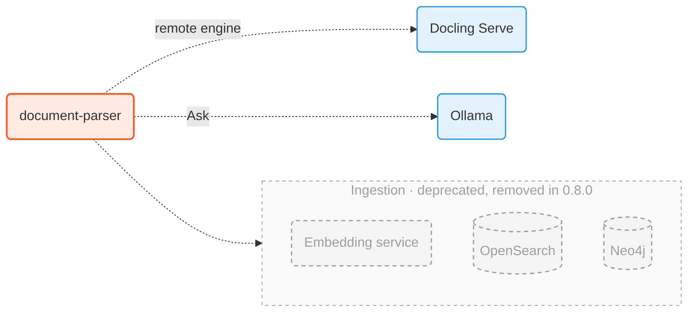

# Configuration

Docling Studio reads its settings from environment variables. This page lists them, starting with the ones you are likely to change. The backend reads most of them in [`document-parser/infra/settings.py`](https://github.com/scub-france/Docling-Studio/blob/main/document-parser/infra/settings.py); nginx and the embedding service read their own.

- With `docker run`, pass them with `-e NAME=value`.
- With Docker Compose, put them in a `.env` file next to `docker-compose.yml`. Compose only forwards the variables listed under `document-parser` › `environment` in `docker-compose.yml`. To set another one, add it there or in a `docker-compose.override.yml`.

The server checks most values when it starts. If one is invalid, it does not start and the logs say which one.

## Analysis

| Variable | Default | What it does |
|----------|---------|--------------|
| `CONVERSION_ENGINE` | `local` | `local`: Docling runs in the backend. `remote`: PDFs go to Docling Serve. The `-local` and `-remote` images set it for you. |
| `DOCLING_SERVE_URL` | `http://localhost:5001` | Docling Serve address. Remote engine only. |
| `DOCLING_SERVE_API_KEY` | empty | Key sent to Docling Serve, if it needs one. |
| `DEFAULT_TABLE_MODE` | `accurate` | How tables are read: `accurate` or `fast`. |
| `MAX_CONCURRENT_ANALYSES` | `3` | How many analyses run at the same time. |
| `CONVERSION_TIMEOUT` | `900` | Seconds before an analysis is stopped. |
| `BATCH_PAGE_SIZE` | `0` (compose: `10`) | Local engine only. Converts long PDFs in batches of this many pages, which bounds memory use and shows the progress after each batch. A table that runs across two batches comes out as two tables. `0` converts in one pass. |

Two more timeouts exist, in seconds: `DOCUMENT_TIMEOUT` (120) and `LOCK_TIMEOUT` (300). The server only starts if `DOCUMENT_TIMEOUT` < `LOCK_TIMEOUT` < `CONVERSION_TIMEOUT`. So a `CONVERSION_TIMEOUT` of 300 or less needs a lower `LOCK_TIMEOUT` as well.

## Limits

| Variable | Default | What it does |
|----------|---------|--------------|
| `MAX_FILE_SIZE_MB` | `50` | Largest upload, in MB. `0` means no limit. |
| `MAX_PAGE_COUNT` | `0` | Most pages per PDF. `0` means no limit. |
| `MAX_FILE_SIZE` | `0` | Local engine only. Largest PDF Docling converts, in bytes: Docling refuses a bigger file and the analysis fails. `0` means no limit. This is not the upload limit, `MAX_FILE_SIZE_MB`. |
| `MAX_IMPORT_TABLE_CELLS` | `100000` | Most table cells in an imported Docling JSON, all tables together (rows × columns of each table). A larger document is refused with a 400. `0` means no limit. The import body itself is capped at 200 MB. |
| `NGINX_MAX_BODY_SIZE` | `200M` | Upload limit in nginx, in nginx format. Keep it above `MAX_FILE_SIZE_MB`. |
| `RATE_LIMIT_RPM` | `100` | Requests per minute per client address, as the backend sees it. In the single image, that is the address that reached nginx. With Docker Compose, the backend does not trust the nginx container by default, so all users share the limit until `FORWARDED_ALLOW_IPS` names it. `0` turns it off. `/api/health` is not counted. |
| `FORWARDED_ALLOW_IPS` | `127.0.0.1` | Read by uvicorn: the proxies trusted to set `X-Forwarded-For`. The client address is the right-most one that is not trusted. Behind your own reverse proxy, add its address so the rate limit counts per client instead of per proxy. Never set it to `*`: the client would then choose its own address. |

## Ask

Ask is hidden by default. `ASK_MODE=visible` shows it: the Ask tab in the Parse view, and the reasoning settings in **Settings** › **Ask**. Hidden, there is no Ask tab, even when reasoning was turned on in **Settings**, and **Settings** › **Ask** only shows *Hidden* and how to show Ask. `ASK_MODE` only hides Ask: the reasoning API still answers as the values below say.

Ask runs on Ollama, the only backend docling-agent drives: there is no provider setting.

The other values are starting values. **Settings** › **Ask** in the app can change them while the server runs. After a **Save** there, the four values come from the database until you click **Reset to environment**.

| Variable | Default | What it does |
|----------|---------|--------------|
| `ASK_MODE` | `hidden` | `visible` shows Ask in the app, `hidden` hides it. |
| `REASONING_ENABLED` | `false` | Turns Ask on. The reasoning packages must be in the image. |
| `OLLAMA_HOST` | `http://localhost:11434` | Ollama address, as seen from the backend. In a container, use `http://host.docker.internal:11434`. |
| `REASONING_MODEL_ID` | `gpt-oss:20b` | Default model. It must be pulled in Ollama. |
| `REASONING_MAX_ITERATIONS` | `5` | Most reasoning steps per question, from 1 to 20. |

## Feature switches

| Variable | Default | What it does |
|----------|---------|--------------|
| `RAG_PIPELINE_ENABLED` | `true` | The Docs and Runs pages. |
| `STUDIO_MODE_ENABLED` | `false` | The older Studio pages (`/studio`, `/history`, `/documents`, `/search`), which still hold chunking and ingestion (deprecated). |
| `INSPECT_MODE_ENABLED` | `true` | The document page (`/docs/{id}`). `false` sends anyone who opens a document back to **Docs**, with a warning. Results under **Analyses** still open. |

At least one of `RAG_PIPELINE_ENABLED` and `STUDIO_MODE_ENABLED` must be `true`.

### Read but unused

The backend still reads three more variables and returns them in `/api/health`, but no screen uses them: changing them changes nothing in the app. A negative `MAX_PASTE_IMAGE_SIZE_MB` or an empty `PASTE_ALLOWED_IMAGE_TYPES` still stops the server at start.

| Variable | Default | In `/api/health` |
|----------|---------|------------------|
| `LINKED_MODE_ENABLED` | `true` | `linkedModeEnabled` |
| `MAX_PASTE_IMAGE_SIZE_MB` | `10` | `maxPasteImageSizeMb` (`null` when `0`) |
| `PASTE_ALLOWED_IMAGE_TYPES` | `image/png,image/jpeg,image/webp` | `pasteAllowedImageTypes` |

## MCP server

The [MCP server](mcp-server.md) lets AI agents read and cite your documents at `/mcp`. It is on by default, except with `DEPLOYMENT_MODE=huggingface`, and it has no authentication.

Its seven variables are described in [Turn it on or off](mcp-server.md#turn-it-on-or-off): `MCP_ENABLED`, `MCP_ALLOWED_HOSTS`, `MCP_STUDIO_BASE_URL`, `MCP_MAX_READ_TOKENS`, `MCP_MAX_ROUNDS`, `MCP_APPS_ENABLED` and `MCP_CITATION_CARD`. Docker Compose forwards the first three only.

**Settings** › **MCP server** turns the server off and on while it runs, and **Settings** › **Read budgets** changes `MCP_MAX_ROUNDS`, `MCP_MAX_READ_TOKENS` and `MCP_STUDIO_BASE_URL` without a restart.

## Optional services



None of them is needed to import and analyze PDFs.

### Ingestion (deprecated)

> **Deprecated.** Ingestion will be removed in 0.8.0, with everything built on it: the embedding service, OpenSearch, Neo4j and its graph view, the stores and the chunk search. Avoid it in new setups.

Ingestion sends chunks to OpenSearch or Neo4j. It turns on when `EMBEDDING_URL` is set together with `OPENSEARCH_URL` or `NEO4J_URI`. Only the older Studio pages use it, so it also needs `STUDIO_MODE_ENABLED=true`.

| Variable | Default | What it does |
|----------|---------|--------------|
| `EMBEDDING_URL` | empty | Embedding service address. Empty means no ingestion. |
| `OPENSEARCH_URL` | empty | OpenSearch address. Empty means OpenSearch is not used. |
| `OPENSEARCH_DEFAULT_LIMIT` | `1000` | Most chunks returned when a document's chunks are read back from OpenSearch. |
| `EMBEDDING_DIMENSION` | `384` | Vector size. It must match the embedding model. |
| `DEFAULT_EMBEDDER` | `bge-m3` | Embedder name recorded on the `default` store when the database creates it. |
| `NEO4J_URI` | empty | Neo4j address, for example `bolt://neo4j:7687`. Empty means Neo4j is not used. |
| `NEO4J_USER`, `NEO4J_PASSWORD` | `neo4j`, `changeme` | Neo4j login. Change the password. |
| `STORE_SECRET_KEY` | empty | Encrypts store passwords in the database. Required as soon as a store has a password, and it must never change. |

Create a `STORE_SECRET_KEY` with the image itself:

```bash
docker run --rm ghcr.io/scub-france/docling-studio:latest-remote python -c "from cryptography.fernet import Fernet; print(Fernet.generate_key().decode())"
```

With Docker Compose, the `ingestion` profile starts OpenSearch, the embedding service and Neo4j, and the extra file connects the first two:

```bash
docker compose --profile ingestion -f docker-compose.yml -f docker-compose.ingestion.yml up --build
```

For Neo4j, also put `NEO4J_URI=bolt://neo4j:7687` in `.env`. The embedding service reads `EMBEDDING_MODEL` (default `all-MiniLM-L6-v2`) and `EMBEDDING_BATCH_SIZE`, the number of texts it encodes per batch (default `64`).

These compose settings are for a laptop: OpenSearch runs without security and Neo4j with the default password. Do not expose them.

## Deployment

| Variable | Default | What it does |
|----------|---------|--------------|
| `DEPLOYMENT_MODE` | `self-hosted` | `huggingface` shows a demo banner, makes **Settings** › **Ask** and the MCP sections of **Settings** read-only, and turns the MCP server off unless `MCP_ENABLED=true`. |
| `CORS_ORIGINS` | `http://localhost:3000,http://localhost:5173` | Browser origins allowed to call the API, comma-separated. Only needed when the UI is served from another address. |
| `UPLOAD_DIR` | `/app/uploads` in the images | Folder for uploaded PDFs. |
| `DB_PATH` | `/app/data/docling_studio.db` in the images | SQLite database: documents, analyses, stores and settings saved in the app. |
| `APP_VERSION` | `dev` | Version shown in the app. The release build sets it. |

## Build options

Used when you build the image yourself, with `docker build --build-arg` or as variables for `docker compose up --build`.

| Name | Default | What it does |
|------|---------|--------------|
| `CONVERSION_MODE` | `local` | Compose only. Which image to build: `local` or `remote`. |
| `WITH_REASONING` | `false` | Installs the packages Ask needs. `local` image only. |
| `BAKE_MODELS` | `false` | Downloads Docling's models into the image at build time. `local` image only. The backend does not point Docling at this copy yet, so the first analysis still downloads them. |
| `APP_VERSION` | `dev` | Version baked into the single image (root `Dockerfile`). |

Example, the single image with Ask:

```bash
docker build --target local --build-arg WITH_REASONING=true -t docling-studio .
```

## Where data lives

| Setup | Database and PDFs |
|-------|-------------------|
| `docker run` | Inside the container, in `/app/data` and `/app/uploads`. Mount volumes to keep them. |
| `docker-compose.yml` | Docker volumes `db_data` and `uploads_data`. |
| `docker-compose.dev.yml` | `document-parser/data` and `document-parser/uploads` in your clone. |
