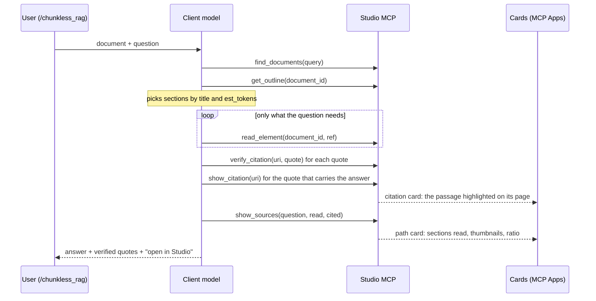

# Design: MCP server — back to a simple Chunkless RAG surface

- **Issue:** #363
- **Title on issue:** [ENHANCEMENT] MCP — reduce the server to the Chunkless RAG loop
- **Author:** Pier-Jean Malandrino
- **Date:** 2026-10-26
- **Status:** Accepted
- **Target milestone:** 0.8.0 — Production ready · demo at BDX I/O on **2026-10-29**
- **Impacted layers:** backend: domain | services | persistence | infra (settings) | `mcp_adapter` · frontend: none (deep link already shipped) · infra/CI: `.env.example`, compose
- **Audit dimensions likely touched:** KISS · Performance · Decoupling · DRY · Tests · Documentation · Security
- **ADR spawned?:** proposed — *"Studio does not journal an agent's reasoning: the trail is projected from the anchors it read and cited"* (a deliberate non-action that reverses #329's "the server keeps the plan")

Related: PR #328 (head `97d21ba`), issues #327, #329, #330, #331–#335.

---

## 1. Problem

PR #328 started as "lot 1": four read tools that let a client model do
**Chunkless RAG** over a Docling parse. The model reads the map first, then
only the sections it needs, and cites with anchors the server can check.

The PR has since grown into two products:

- **#327, the read surface:** 4 tools.
- **#329, an investigation journal on top:** 6 more tools, 3 SQLite tables,
  an adjudicator, retry budgets and refusal rules.

Two MCP Apps viewers come on top of both, 2,700 lines of HTML. In all, the PR
adds 12 model-visible tools plus 2 app-only ones, 2 prompts, 9 env vars and
8,900 lines of production code.

On Thursday the surface goes on stage at BDX I/O, as *Chunkless RAG*. The
story must land in two minutes:

> No chunks, no embeddings, no vector store. The model reads Docling's
> structure like a table of contents, opens only what it needs, and every
> quote it publishes is checked by the server.

The current surface buries that story. In an investigation the model spends
turns on bookkeeping: `plan_steps`, `record_attempt`, refused closes. And what
the model pays for on every connection has doubled for a protocol the demo
does not need.

The two MCP Apps cards are **the show**, and they stay. One is the passage
highlighted on its page; the other is the path through the document, with page
thumbnails. What changes is what feeds the path card: the anchors the model
read and cited, instead of a journal it must keep.

## 2. Goals

- [ ] What the model sees **is** the Chunkless RAG loop: map → read → cite →
      verify → show, in **6 model-visible tools** (4 read, 2 cards) and
      **1 prompt**.
- [ ] The always-paid context drops by about 40%: ≤ 900 tokens for
      instructions plus visible tools, against ~1,490 today.
- [ ] **Both MCP Apps cards render on the demo client.** The citation card is
      unchanged. The path card shows the sections read, in reading order,
      each with its page thumbnail, and the cited ones highlighted.
- [ ] "Where did the answer come from" needs no protocol. It is projected from
      the anchors the agent read and cited, with **tokens read against the
      whole document**, the Chunkless RAG metric, in the card's header.
- [ ] The demo runs end to end, live, on the chosen client, **5 times in a
      row** without a refused call.
- [ ] PR #328 shrinks to what the demo shows. The journal leaves the PR
      intact, on a branch of its own.

## 3. Non-goals

- **Search inside a document**, keyword or semantic. The demo is about
  navigation; neither docling-agent nor this server searches. It becomes the
  first follow-up if needle-in-a-haystack questions matter.
- **Multi-document questions.** `find_documents` stays a filename lookup.
- **Authentication.** Localhost only, as today; HF Space keeps `MCP_ENABLED=false`.
- **#330**, replaying the trail in the Parse-view timeline. It comes after the
  demo. A deep link carrying several refs is its natural first step.
- **The wire diet of §5.5.** Only its zero-risk items are in scope for Thursday.
- **Porting #331–#335 as written** (unpushed, on `backup/mcp-331-335-unpushed`).
  §5.8 triages them; most of their scope disappears with the journal.
- **Aligning Studio's *Ask* (docling-agent) on the MCP reader.** It is named
  in §4.4 and §8 as a demo caveat. Fixing it is its own issue.

## 4. Context & constraints

### 4.1 What PR #328 contains today

| Area | Model-visible tools | Production lines | Commits (fix / total) |
|------|--------------------|-----------------:|----------------------:|
| Read surface: outline, reader, wire | `find_documents`, `get_outline`, `read_element` | 2,055 | 5 / 18 |
| Citations and anchors | `verify_citation` | 535 | 3 / 9 |
| Investigation journal (#329) | `open_investigation`, `plan_steps`, `record_attempt`, `abandon_step`, `close_investigation`, `get_investigation` | 1,841 + 3 tables | 8 / 13 |
| MCP Apps: 2 viewers, page raster | `show_citation`, `show_investigation` (+ app-only `get_citation_image`, `get_investigation_page`) | 3,289 | **10 / 25** |
| Prompts | `cite_answer`, `investigate` | 129 | 2 / 7 |
| Transport: HTTP mount, stdio | — | 229 | 3 / 10 |

Overall: +8,876 production lines, +5,407 test lines, +1,008 doc lines. Of
45 non-merge commits, 21 are `fix`. Commits count when they touch a file of
the area, so one commit can count in several rows.

**Measured cost.** Measured with an in-memory client, the way
`test_mcp_*.py` does; tokens ≈ chars / 4.

| | Journal and apps on | Apps only | Read surface only |
|---|---:|---:|---:|
| What a Claude host shows the model (instructions, plus name, description and input schema of each visible tool) | **~1,490 t** | ~730 t | **~650 t** |
| Everything sent on connect (incl. output schemas, app-only tools) | ~7,900 t | ~3,500 t | ~2,800 t |

- `test_mcp_surface` caps the first line at 6,000 chars. Today it sits at
  5,973: 27 chars of headroom.
- Output schemas are 72% of the bytes sent. A third of that is generated
  `title` keys and developer docstrings copied into `$defs`.
- **Every result is sent twice:** compact `structuredContent`, then the same
  JSON pretty-printed as text. That is 2.3 to 3.3 times the useful payload.

**On a real document**, an arXiv paper of 21 pages, 1,004 text items and
~16.5k tokens:

| Call | Cost |
|---|---:|
| `get_outline` | ~940 t |
| Median section read | ~990 t, 69% of it document text |
| A `cite_answer` run: find → outline → read → verify | ~2.2k t |
| An `investigate` run: find → open → plan → 2 × (read + attempt) → close | ~3.5k t, twice the calls |

### 4.2 What works — keep it

1. **The loop itself.** Map before text, with a reading cost per entry
   (`est_tokens`). Then budgeted reads that resume at `ref@offset`, and
   server-side quote verification that tolerates what models change when they
   copy text (NFKC, typographic quotes, soft hyphens, table pipes,
   whitespace). This *is* Chunkless RAG, and it already does better than
   docling-agent on the four points of §4.4.
2. **Anchors pinned to the parse** (`dstudio://doc/{id}@{version}#{ref}`). A
   re-parse renumbers docling refs, so an anchor without a version would lie.
3. **Real documents are handled.** A preamble node keeps the text before the
   first heading, such as a contract's parties. Below two headings the map
   falls back to pages. Sections include their nested subsections, and
   tables render as markdown.
4. **Security posture.** Document text is delimited and its delimiters
   neutralised. Input and output are bounded, tools take identifiers only, and
   nothing writes to documents. It was live-tested over stdio, over HTTP with
   two concurrent clients, and through nginx (a forged `Host` is refused).
5. **Deep links into Studio** (`/analyses/{version}?ref=…&page=N`). About 30
   frontend lines open Studio's own viewer at the cited element, with its box
   on the page and the tree beside it. The cards show the passage inside the
   chat; the deep link carries the audience on into Studio itself.
6. **The two cards render what text cannot.** The citation card shows the
   quote highlighted on its page, full screen on demand. The path card shows
   each section visited with its page thumbnail, and a lens to zoom and leaf
   through the pages. Page images travel only between card and server, never
   through the model's context.
7. **Hexagonal discipline.** Tools are mapping only. Domain modules are pure,
   and `test_architecture.py` enforces the boundaries.

### 4.3 What does not work — change it

1. **Two products in one PR.** The journal is a workflow engine for the model.
   The plan is recorded once, every ref costs an attempt, steps run out of
   budget, and closing is refused in three cases.
   - It speaks *investigation*, not Chunkless RAG.
   - On stage, a refused `close_investigation` means dead air while the model
     recovers.
   - It doubles both the calls and what the model sees.
   - It nearly doubles the PR, and it was the area that needed the most
     follow-up fixes (8 of 13 commits).
2. **The two MCP Apps are the show, and also the most fragile part.**
   - Their 3,289 lines carry 10 fix commits out of 25: frame sizing, a host
     that cached a template across three restarts (hence the versioned
     `ui://` uris), transport gating.
   - Claude Code does not render them; it gets the same record as text.
   - **Decision: keep them**, change as little of their HTML as possible,
     freeze the host version, and rehearse on it (§8).
   - The path card is wired to the journal (`show_investigation` reads an
     investigation), so it must change source; see §5.6.
3. **The read result carries more envelope than it needs.**
   - Every element read brings a full `CitationRef`. Its `uri` holds two
     UUIDs, ~97 chars. Its `ref` is already inside that `uri`. Its 8-word
     `preview` repeats the text sitting in `content`.
   - The server itself budgets 60 tokens of anchor per element.
   - On a short section, `citations[]` (701 chars) outweighs the text
     (366 chars). On the real paper the envelope is still 31% of a read.
4. **`verify_citation` returns viewer data to the model.** It sends bbox,
   `coord_origin`, page width and height, `quote_hash` and headings: 493 of
   its 727 chars. The model needs `status`, the anchor to cite and the
   deep link.
5. **Every result is sent twice** (see §4.1). Whether the model reads one copy
   or both depends on the host. Either way, the bytes are paid on the wire.
6. **Config sprawl.** Of nine env vars, three exist only for the journal, one
   only switches the viewers, and `MCP_CACHE_TTL_SECONDS` is a caching hint
   nobody tunes.
7. **Two "chunkless" paths that do not read the same text** (§4.4). Ask runs
   docling-agent with its own section reader, which drops tables. The MCP
   reader renders them. The same question can get two answers from the same
   document.

### 4.4 docling-agent's Chunkless RAG loop next to this surface

docling-agent 0.6.0, `DoclingRAGAgent._rag_loop` (`docling_agent/agent/rag.py:194-330`):

| Step | docling-agent | This MCP surface |
|------|---------------|------------------|
| Map | `create_document_outline`: headings plus refs only, no depth limit, no cost, re-sent every turn | `get_outline`: depth 1–6, max 200 nodes, `est_tokens`, preamble, page fallback |
| Select | `_select_section`: "the single most relevant UNVISITED section", JSON `{reason, section_ref}`, falls back to `unvisited[0]` | the client model reasons; no tool needed |
| Read | `_get_section_content`: plain text, no refs, tables and pictures dropped | `read_element`: markdown with tables, one anchor per element, budget, cursor |
| Enough? | `_attempt_answer`: JSON `{can_answer, response}` | the client model decides |
| Cap | `max_iterations` = 5 | none; the client stops |
| Cite | free text, no citations | `verify_citation`, server-side |
| Trace | one `READ` step per iteration: `section_ref` plus `reason` | none in the 4 tools; the journal's `record_attempt.thought` |

Two conclusions follow.

**The four read tools already are the loop.** What the journal adds (plans,
verdicts, budgets) has no counterpart in the loop the talk is named after.

**The trace docling-agent produces is "the sections visited, and why".** That
is what a reader of the demo needs to see, and it can be computed from the
anchors alone (§5.1).

Duplication worth knowing about, out of scope here:

- The heading-stack walk exists three times:
  - `domain/outline_builder.py:75-168`
  - `services/chunk_service.py:885-939`
  - `domain/parse_index.py:91-106`
- `domain/element_reader.py` re-does docling-core's markdown serializers. It
  renders tables, which docling-agent's reader does not.

### 4.5 Hexagonal Architecture constraints (backend)

Nothing crosses a boundary. The new projection (§5.1) is pure domain and
reuses `containing_chain` from `domain/investigation_map.py`, moved next to
the outline code. Removing the journal removes one port
(`InvestigationRepository`), one repo and one service. The
`test_architecture.py` rules for `mcp_adapter` keep holding.

### 4.6 Deployment modes

| Mode | Behaviour |
|------|-----------|
| `latest-local` | Unchanged: MCP off by default, on with `MCP_ENABLED=true`. |
| `latest-remote` | Unchanged. |
| HF Space | MCP stays off. |
| stdio (`mcp_stdio.py`) | Stays: the simplest setup for a laptop demo, with no port and no proxy. |

No `/api/health` flag is involved.

### 4.7 Hard constraints

- **Deadline:** the demo is Thursday 2026-10-29. Anything not done by
  Wednesday noon falls back to Alternative A (§6).
- **Schema:** the journal tables were never released, so dropping them needs
  no migration.
- **PR #328 targets `release/0.7.3`.** Its CHANGELOG entry sits under 0.7.3
  `Unreleased`, while the issues carry milestone 0.8.0 (§11).

## 5. Proposed design

Subtract the journal, keep both cards, and feed the path card from one small
stateless tool. Everything removed stays reachable on a branch.



### 5.0 Target surface

| Kind | Name | Change |
|------|------|--------|
| Tool | `find_documents` | unchanged |
| Tool | `get_outline` | unchanged |
| Tool | `read_element` | unchanged on Thursday; envelope diet afterwards (§5.5) |
| Tool | `verify_citation` | stops returning viewer geometry (§5.5, item 1) |
| App tool | `show_citation` | **unchanged**, the citation card |
| App tool | `show_sources` | **new**, stateless; renders in the path card, the investigation card re-fed (§5.6) |
| App-only | `get_citation_image`, `get_source_page` (was `get_investigation_page`) | unchanged behaviour; both are already stateless (anchor + page) |
| Prompt | `chunkless_rag` | replaces `cite_answer` and `investigate` (§5.7) |

The rest is removed from the PR: the 6 journal tools, `show_investigation`
(replaced by `show_sources` on the same card) and the `investigate` prompt.

### 5.1 Domain

`SourceMap`, a pure projection in `domain/navigation.py` or a new
`domain/source_map.py` (≤ 300 lines). It takes:

- a `DocumentOutline`;
- the parse's `DocumentIndex`;
- `cited`, a list of anchors;
- `read`, a list of refs.

It returns two views of the same anchors:

- **the map:** the outline nodes those anchors fall in, in document order.
  Each node is marked `cited`, `read`, or `path` (the ancestor of a node
  read), and keeps its `est_tokens`;
- **the reading order:** one hop per section read, in the order the model
  read them. Each hop carries its `why` and its cited anchors, if any.

The totals cover sections read, tokens read, the document's
`total_est_tokens` and their ratio.

That reading order has the same shape as docling-agent's trace, one READ per
section with its reason. So #330 can later replay it on the #303 timeline in
the Parse view without a new format.

The containment logic already exists and is tested: `containing_chain` in
`domain/investigation_map.py:127`. It moves out of the journal module,
unchanged, together with its tests.

### 5.2 Persistence

No new table. The three journal tables (`investigations`,
`investigation_steps`, `investigation_attempts`) leave `database.py` with
`persistence/investigation_repo.py`. They were never released, so no
migration is needed.

### 5.3 Infra adapters

`infra/settings.py` goes from 9 MCP variables to 5:

| Keep | Drop |
|------|------|
| `MCP_ENABLED`, `MCP_ALLOWED_HOSTS`, `MCP_STUDIO_BASE_URL`, `MCP_MAX_READ_TOKENS`, `MCP_APPS_ENABLED` | `MCP_INVESTIGATION_ENABLED`, `MCP_MAX_ATTEMPTS_PER_STEP`, `MCP_MAX_STEPS_PER_INVESTIGATION`, `MCP_CACHE_TTL_SECONDS` |

`infra/page_raster.py` stays: both cards render pages through it.
`MCP_CACHE_TTL_SECONDS` goes, but the versioned `ui://` uris stay. They are
what keeps a host from showing an old card after a redeploy.

### 5.4 Services

- `NavigationService.source_map(read, cited)`:
  - resolves the document and pinned version from the anchors;
  - refuses anchors that span two documents or two versions;
  - loads the outline and index, and calls the projection.
- Each node carries a deep link, as citations already do.
- An unknown anchor is flagged in the result, never dropped silently.

`InvestigationService` and `investigation_adjudicator` leave.
`CitationService` and `CitationImageService` are unchanged.

### 5.5 MCP adapter (this feature's "API")

**`show_sources(question: str, read: list[{uri, why}], cited: list[str] = [])`**,
read-only, bound to the path card's `ui://` template.

- `read` lists the `uri` of each `read_element` result, in reading order, with
  one line of `why`.
- `cited` lists the verified anchors.
- All anchors are ones the server issued; the model never builds one.

On hosts with MCP Apps, the result renders in the path card (§5.6). Everywhere
else, Claude Code included, the same result reads as text:

```text
Read 3 of 24 sections — 2,140 of 16,480 tokens (13 %).
├─ 2 Method                       read   ~810 t
│  └─ 2.3 Training setup          cited  ~420 t   → open in Studio
└─ 4 Results                      cited  ~910 t   → open in Studio
```

The structured content carries the card's payload: map nodes, reading hops,
totals and deep links.

**Wire diet.** Items 1 and 2 are zero-risk and in scope for Thursday; the
rest comes after the demo.

1. `verify_citation` returns `status`, `valid`, `actual_quote`, the anchor to
   cite, its page and `deep_link`. Geometry and `quote_hash` stay server-side
   for whatever renders them.
2. Results are sent once. The text block becomes compact JSON or a one-line
   summary instead of a pretty-printed duplicate of `structuredContent`.
   *Done as compact JSON for the read tools and `show_citation`, and as a text
   tree for `show_sources`. The page tools keep the default: their payload is
   the image.*
3. Output schemas lose generated `title` keys and developer docstrings in
   `$defs`.
4. `read_element` stops repeating itself:
   - `content` marks each element `[n]`;
   - `citations[n]` keeps `uri` and `page` only, without `ref` or `preview`.
5. Shorter anchors: an 8-hex handle per id, resolved server-side and refused
   when ambiguous. This saves ~50 chars per anchor and is the biggest
   remaining lever on small sections.

### 5.6 MCP Apps (the cards) and frontend

**Citation card** (`citation_app.html`, `show_citation`, `get_citation_image`):
no change.

**Path card** (`investigation_app.html`): the investigation card, re-fed by
`show_sources`. Most of it is already independent of the journal:

| Part of the card | Today's source | With `show_sources` | HTML change |
|------------------|----------------|---------------------|-------------|
| **Path** tab: hop tiles, page thumbnails, lens (zoom, leaf through pages) | steps and their map nodes; images via `get_investigation_page(uri, page)` | one hop per section read; same image tool, already stateless | none, beyond the hop label |
| Tree (`nodeRow`) | map statuses `kept` / `rejected` / `visited` / `path` | `cited` → `kept`, `read` → `visited`, ancestor → `path`; `rejected` never occurs | none |
| **Record** tab: steps, attempt pips, verdicts (`stepBlock`, `pips`, `attemptRow`) | the journal's steps and attempts | the reading order: section title, `why`, cited quotes | yes: one hop per row, pips and attempt budget hidden |
| Header tally (`tally`) | steps answered / unanswered / pending, attempts kept | **"Read 3 of 24 sections — 2,140 of 16,480 tokens (13 %)"** | yes: one line |
| Answer, `stale` banner | the journal's close | none | hidden when absent |

- The card's title becomes *Sources*; its first tab, *Reading*.
- Its `ui://` uri changes with its content (it is versioned), so no host shows
  the old card.
- `get_investigation_page` becomes `get_source_page`. It is app-only and the
  model never sees it; renaming it cost one string in the card.

**Frontend:** nothing for Thursday. Single-ref deep links already work
(`frontend/src/pages/DocParseTab.vue`, `routes.ts`). A `?refs=a,b,c` variant
that highlights every cited element belongs to #330.

### 5.7 Cross-cutting

- **Server instructions:** the four-step loop, then the two cards.
- **The prompt `chunkless_rag`** (`document`, `question`) folds `cite_answer`
  into five steps:
  1. find;
  2. outline, choosing by title and cost;
  3. read only those entries, then verify every quote;
  4. `show_citation` on the one quote that carries the answer;
  5. `show_sources` with the reading order and the cited anchors, and answer
     with the deep links.

  On the client's menu the name tells the story ("/chunkless_rag"). The
  `evidence=images` parameter goes: showing the cards is the default when the
  host renders them.
- **Docs:** `docs/mcp-server.md` shrinks to the loop, the anchors, the two
  cards, the five env vars and security. The journal section goes.

### 5.7b Rounds — a bounded, explained loop (added 2026-10-26)

The trail keeps a reasoning without bringing a protocol back: the prompt runs
docling-agent's loop. Each round picks one section, says why, reads it and
says what it found; at most `MAX_ROUNDS` rounds (5, the same cap as Studio's
own Ask); a `cursor` continuation is the same round.

- `show_sources` takes `read[]` as rounds: `{uri, why, found}`.
- The card numbers each round against the cap (`2/5`) and states it in its
  summary ("2 of 5 rounds · …"). Past the cap, it says so in red.
- The cap lives in `services/navigation_config.py` (`MAX_ROUNDS`), not in an
  env var. It is not enforced: the server is stateless and the client model
  drives the loop. The prompt states it; the card makes a breach visible.

### 5.7c The cards, redesigned for the stage (added 2026-10-26)

Mockups were made on a design canvas and option A was chosen, with B's
filmstrip kept as a second tab.

- **Sources card.** It was revised after the first live run, where a large
  figure and a one-box fan-out read oddly. It is now one view: each round
  beside its real page with the passage boxed, then *pourquoi*, *trouvé* and
  a link into Studio. A compact band above holds the share read, the round
  gauge and a thin map of the document (one segment per section, the
  sections read lit). Unused rounds are one quiet line, not empty tiles.
- **`show_sources`** now also returns `segments`: every outline section with
  its own tokens and status (`domain/source_bar.py`). The subsections of a
  section read whole are lit with it.
- **Citation card.** It makes one claim, *texte exact du document*, and
  shows the page with the passage boxed, then the passage large; a long one
  folds to seven lines. Element id, parse version and quote hash are gone.
  The badge does not say "vérifiée": `show_citation` shows the server's text
  at the anchor, it does not check a quote.
- **Both cards** are light only and in French.

### 5.8 Where the removed work goes

| Work | Goes to |
|------|---------|
| Journal (#329) | Branch `feature/329-mcp-investigation-journal`, cut at `97d21ba` before the removal commits. Unmerged; #329 stays open as *parked*, or closes as superseded by `show_sources` (§11). |
| `show_investigation` | Replaced by `show_sources` on the same card; the journal version stays on the branch above. |
| #331 dispatch, doc resolution, reaping | Moot without the journal. |
| #332 light parse lookups | Partly redone on the remote (`873f4e8`, parse ids instead of rows). Re-check the rest against the read surface. |
| #333 raster cache: render a page once | **Relevant again**: the path card asks for a thumbnail per hop, and the lens for full pages. Port it from `backup/mcp-331-335-unpushed` (`ece8b9e`) only if the Tuesday dry run shows slow thumbnails. |
| #334 slim results | Becomes the wire diet, §5.5 items 3–5. |
| #335 resources catalogue, one-turn close | Close moot; the catalogue is a later idea, not demo scope. |

## 6. Alternatives considered

### Alternative A — Demo the PR as it is

- **Summary:** run `/investigate` on today's code. Both cards are there, and
  it was live-tested on 2026-09-24 over stdio, HTTP and nginx. Zero code risk.
- **Why not as the plan:**
  - The model works through the journal protocol on stage: plan, attempts,
    and a close that can be refused.
  - The story is told as an *investigation*, not as Chunkless RAG.
  - It sends twice the calls, and the model sees ~1,490 t on every
    connection.
  - The PR stays at 8,900 lines.
- **Kept as the fallback** if the reworked path card is not solid by
  Wednesday noon. It lives on `feature/329-mcp-investigation-journal`.

### Alternative D — Flags only, no code

- **Summary:** `MCP_INVESTIGATION_ENABLED=false` leaves the 4 read tools,
  `cite_answer` and the citation card: ~730 t visible.
- **Why not:** the path card, the show, disappears with the journal it reads
  from.

### Alternative B — Expose Ask as one tool, `ask(document, question)`

- **Summary:** Studio runs docling-agent's loop with Ollama and returns the
  answer plus its READ trace. One tool, the smallest surface.
- **Why not:**
  - Studio would host an agent, the opposite of the arbitrage taken in
    #327/#329.
  - The demo would need Ollama and a local model on stage.
  - The audience would no longer watch the client model navigate, which is
    the point of the talk.
  - Its reader drops tables, and its answers carry no citations.

### Alternative C — Keep the journal, slimmed

- **Summary:** drop `plan_steps` and `abandon_step`, and let `close`
  auto-settle pending steps.
- **Why not:** it is still a protocol the model must follow, still state,
  still 3 tables and concurrency rules. `show_sources` gives the same card,
  the path on the map with thumbnails, statelessly.

## 7. API & data contract

### MCP tools

| Tool | Input | Output | Breaking? |
|------|-------|--------|-----------|
| `find_documents` | `query?`, `limit?` | unchanged | no |
| `get_outline` | `document_id`, `version_id?`, `depth?` | unchanged | no |
| `read_element` | unchanged | unchanged on Thursday | no |
| `verify_citation` | `uri`, `quote` | `citation` without `bbox`, `coord_origin`, `page_width`, `page_height`, `quote_hash`, `headings` | yes, unreleased |
| `show_citation` | `uri` | unchanged (citation card) | no |
| `show_sources` | `question`, `read: list[{uri, why}]`, `cited: list[uri]` | `map[]` (`ref`, `title`, `status`, `est_tokens`, `page`, `deep_link`), `hops[]` (`uri`, `title`, `why`, `cited[]`), `totals`, `unknown[]`; rendered by the path card | new |
| `get_citation_image`, `get_source_page` (app-only; was `get_investigation_page`) | unchanged | unchanged | no, unreleased |
| 6 journal tools, `show_investigation` | — | removed | yes, unreleased |

### Persistence schema

```sql
-- Removed from init_db (never released, no migration):
-- investigations, investigation_steps, investigation_attempts
```

### Env vars / config

See §5.3: 5 kept, 4 dropped.

### Breaking changes

None for any released version: everything removed only ever lived on the
unmerged PR #328.

## 8. Risks & mitigations

| Risk | Audit dimension | Likelihood | Impact | How we notice | Mitigation / rollback |
|------|-----------------|------------|--------|---------------|------------------------|
| Cutting code three days before the demo breaks the read path | Tests | Medium | High | pytest; Wednesday dry runs | The cut is subtraction behind the existing suite. Fallback branch at `97d21ba`. Alternative A needs no code. |
| The live model skips `verify_citation`, `show_citation` or `show_sources` | KISS | Medium | Medium | Dry runs | The prompt states the steps. `next_step` already steers after each read. 5 rehearsals with the real question. |
| A card misbehaves on the host (frame sizing, cached template) | — | Medium | **High: it is the show** | Dry runs on the exact host version | Freeze the Claude Desktop version: no update before Thursday. The versioned `ui://` uris stay. Fallback A keeps the journal card as it was. |
| Reworking the record tab breaks the path card | Tests | Medium | High | Adapted card tests; dry run | Limit the HTML change to the record tab and the header; the path tab and the lens are not touched. Fallback A. |
| Thumbnails or the lens render slowly on stage | Performance | Medium | Medium | Time it in the dry run | Pages render on demand through pdf2image. If one takes more than ~1 s, port #333's raster cache (`ece8b9e`). |
| Venue network: the model needs internet | — | Medium | High | Rehearse on the venue network or a phone tethering | stdio keeps MCP local. Record a backup video on Wednesday. |
| Deep links need Studio running on the laptop | Documentation | Low | Medium | Dry run | `MCP_STUDIO_BASE_URL` set. Studio started before the talk. |
| Ask and MCP give different answers on a table-heavy section | DRY | High if both are shown | Low | — | Do not demo both on the same table question, or show it on purpose as "why verified citations matter". Follow-up issue. |
| `show_sources` trusts the `read` list the model sends | Security | Low | Low | — | Display only: anchors are resolved server-side, and unknown ones are flagged, never invented. |
| The surface creeps back | KISS | Medium | Medium | `test_mcp_surface` | Lower its cap from 6,000 to ~3,500 chars to lock the simplification in. |

## 9. Testing strategy

### Backend — pytest (`document-parser/tests/`)

- **Removed with the code:**
  - `test_investigation_domain.py`, `test_investigation_end_to_end.py`,
    `test_investigation_repo.py`, `test_investigation_service.py`;
  - `test_mcp_investigation.py`.
- **Kept:** `test_mcp_apps.py`, for the citation card and the shared Apps
  wiring.
- **Adapted:** `test_mcp_investigation_app.py` becomes
  `test_mcp_sources_app.py`. It covers the card fed by `show_sources`: map
  statuses, hops in reading order, the ratio line, and the text fallback when
  the host has no Apps.
- **Moved:** the containment cases of `test_investigation_map.py` follow
  `containing_chain` into `test_source_map.py`.
- **New:**
  - `test_source_map.py`, pure: containment, preamble, page mode, unknown
    anchor, mixed versions refused, totals.
  - `show_sources` adapter tests: text rendering, deep links.
  - `verify_citation` without geometry.
- **`test_mcp_surface`:** the cap drops to ~3,500 chars and the tool list is
  asserted exactly.
- **Architecture tests:** unchanged.
- **Validation:** ruff check, ruff format check and the full suite, from
  `.venv/bin`.

### Frontend — Vitest

No change; `router.test.ts` already covers the deep-link props.

### E2E — Karate UI

No change. If `?refs=` lands with #330, it gets a Karate UI scenario
(`data-e2e` on the highlighted tree rows), never Playwright.

### Manual QA — the demo script

1. Start Studio with `docker compose up`, with `MCP_STUDIO_BASE_URL` set. Make
   sure the demo document is already parsed.
2. Connect Claude Desktop over stdio with the venv interpreter (see
   `docs/mcp-server.md`).
3. Run `/chunkless_rag <document> <question>`. Check:
   - the outline comes before any read;
   - only 1–3 sections are read;
   - every quote is verified;
   - the citation card shows the passage highlighted, and opens full screen;
   - the path card shows the hops with their thumbnails and the ratio, and
     the lens zooms and leafs through pages;
   - a deep link opens Studio on the element.
4. Time the first thumbnail and the first lens page.
5. Repeat 5 times, then once more on the venue network.

### Performance / load

No load claim. The ratio printed by `show_sources` *is* the performance story
of the talk, so check it against the real document's `total_est_tokens`.

## 10. Rollout & observability

### Release branch

The work lands on `feature/mcp-document-server`, as new commits on top of
`97d21ba`, so no force-push is needed. Before the first removal commit, a
branch `feature/329-mcp-investigation-journal` is cut at `97d21ba`. PR #328
then drops `Closes #329`.

### Plan to Thursday

| Day | Work |
|-----|------|
| Mon 26 | This design. File the issue. Pick the demo document and question (§11). |
| Tue 27 | Morning: cut the journal and remove the 4 env vars. Add `show_sources` (domain, service, tool), the `chunkless_rag` prompt and wire diet items 1–2. Afternoon: re-feed the path card (record tab, header). Get the suite green. First dry run on the demo client. |
| Wed 28 | Fix what the dry run showed. Port the raster cache if thumbnails are slow. 5 dry runs. Record the backup video. Freeze the commit and the Claude Desktop version. Fallback deadline at noon (Alternative A). |
| Thu 29 | Demo. |

### Feature flag / staged rollout

`MCP_ENABLED` stays the only switch that matters, off by default.

### Observability

Keep today's logging: a generic error to the client, details in the server
log. Add one `info` line per `show_sources` call with document, sections read
and the ratio. It is useful in rehearsal and costs nothing.

### Rollback plan

- Revert the removal commits, or check out
  `feature/329-mcp-investigation-journal`.
- No data to clean up: dropped tables never existed in a release.

## 11. Open questions

- **Demo client.**
  - Claude Desktop over stdio, since the cards are the show: local, renders
    MCP Apps, links are clickable.
  - Claude Code shows no cards.
  - claude.ai renders them but needs a public HTTPS endpoint, so not for a
    laptop demo.
  - Which Claude Desktop version, and is auto-update off until Thursday?
- **Demo document and question.**
  - The document must be big enough for the ratio to impress: 50–200 pages,
    with real headings.
  - The question needs 2–3 sections, and ideally a table that Docling
    extracted well.
- **Card language:** the citation card speaks French ("Ouvrir dans Studio"),
  the sources card English. Align both on the talk's language?
- **#329 and #331–#335:** park them (open, labelled) or close them as
  superseded by `show_sources`?
- **PR target:** stay on `release/0.7.3`, or move to the 0.8.0 line its issues
  are milestoned for? This decides where the CHANGELOG entry lives.
- **ADR:** write *"the trail is projected from anchors, not journaled"* now,
  or once the journal's fate (parked or closed) is decided?

## 12. References

- **Issue:** https://github.com/scub-france/docling-Studio/issues/363
- **Related PRs / commits:**
  - PR #328, head `97d21ba`
  - issues #327, #329, #330, #331–#335
  - unpushed work on `backup/mcp-331-335-unpushed`
- **ADRs:** proposed, see header
- **Design docs:**
  - `docs/design/329-mcp-investigation-journal-navigation-tree.md`, superseded
    in part by this one
  - `docs/design/303-reasoning-trace-v2-parse-view.md`, the Ask timeline
- **Project docs:**
  - Architecture: `docs/architecture.md`
  - Coding standards: `docs/architecture/coding-standards.md`
  - ADR guide / template: `docs/architecture/adr-guide.md`, `docs/architecture/adr-template.md`
  - Audit master: `docs/audit/master.md`
  - E2E conventions: `e2e/CONVENTIONS.md`
  - MCP reference: `docs/mcp-server.md`
- **External:**
  - docling-agent 0.6.0, `docling_agent/agent/rag.py` (`_rag_loop`, `_select_section`, `_attempt_answer`)
  - MCP Apps (SEP-1865)
